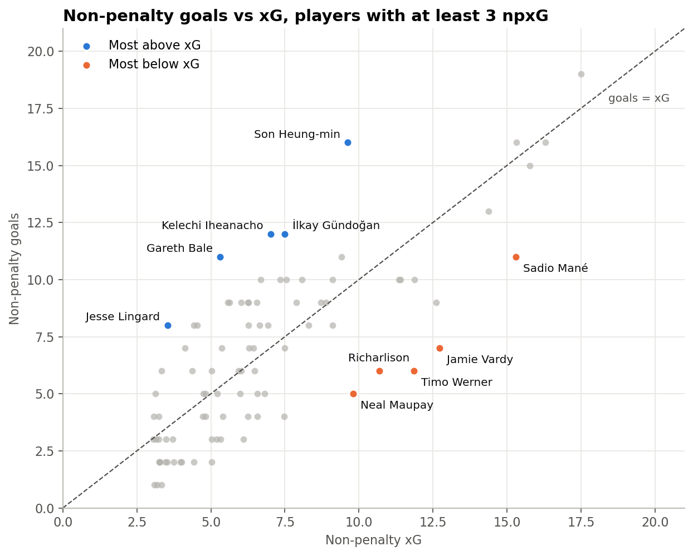
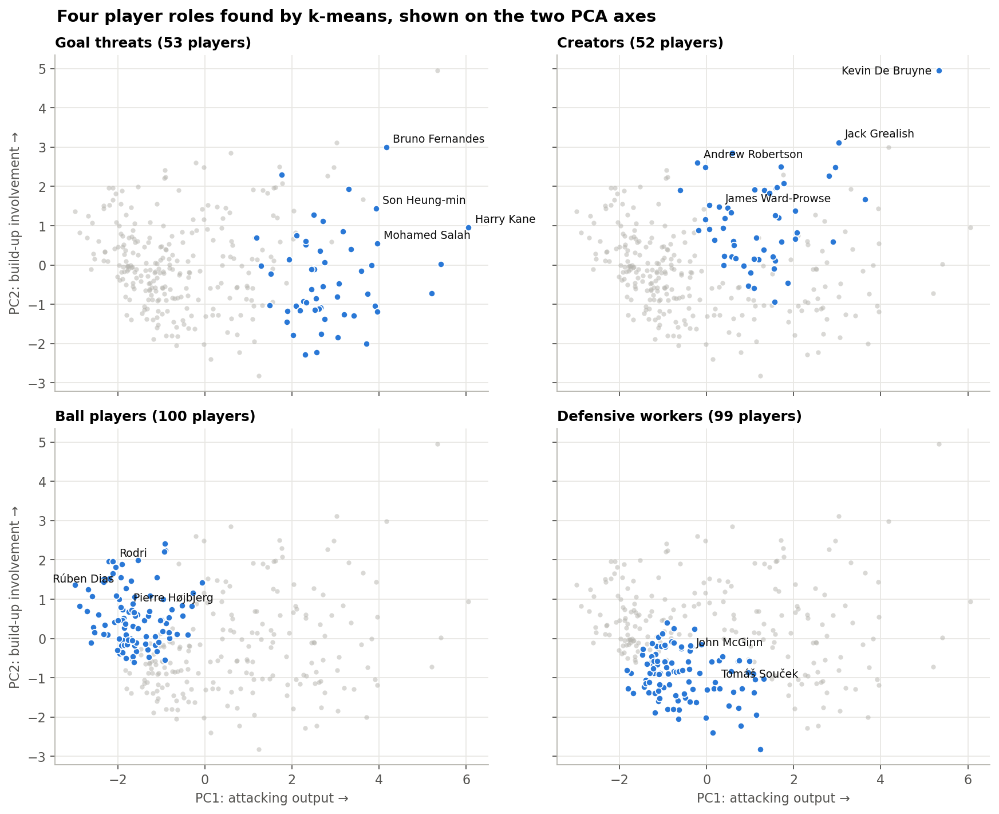
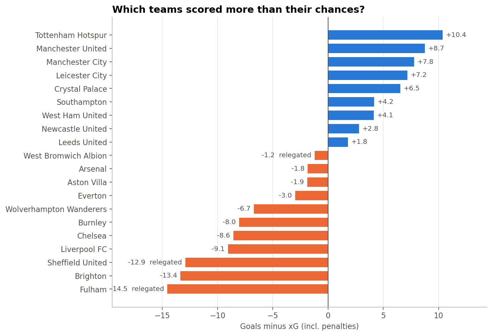

# Who beat their expected goals? Premier League 2020/21

An analysis of every Premier League player in the 2020/21 season, built around one question: which
players and teams scored more or less than the quality of their chances suggested?

Chance quality is measured with expected goals (xG), the probability that a shot becomes a goal based on
where and how it was taken. A player's season xG is roughly what an average finisher would have scored
from the same chances.

The full analysis, with code and charts, is in [the notebook](pl_2020_21_analysis.ipynb).



## Findings

- Over a season, xG predicts goals well. A linear regression of goals on xG gives a slope of 0.99 and
  R² = 0.87.
- Son Heung-min (+6.4) and Gareth Bale (+5.7) scored the most non-penalty goals above their xG. Timo
  Werner (−5.9) and Jamie Vardy (−5.7) were furthest below.
- Fulham and Sheffield United were relegated after scoring 13–15 goals fewer than their xG. Tottenham
  and both Manchester clubs scored well above theirs.
- Forwards get better chances than midfielders: 0.32 vs 0.11 xG per 90 minutes (Welch's t-test,
  p < 0.001).
- Clustering per-90 stats gives four player roles (goal threats, creators, ball players, defensive
  workers) that don't follow the official positions. Andrew Robertson, for example, is listed as a
  defender but groups with the creators.





## Notebook sections

1. Data checks (xG in the data is per 90 minutes, and combined positions like `FW,MF` need handling)
2. Finishing above and below xG, excluding penalties
3. Most goals per 90 minutes (min. 900 minutes played)
4. Playmakers: assists vs expected assists (xA)
5. Teams: goals vs xG, and cards
6. Regression: does xG predict goals? (statsmodels, plus a scikit-learn train/test check)
7. t-test: forwards vs midfielders
8. Player roles with PCA and k-means
9. Radar charts for Kane, Salah, Son and Bruno Fernandes
10. Conclusions and limitations

## Running it

```sh
git clone https://github.com/PellePico/PL_Case.git
cd PL_Case
pip install -r requirements.txt
jupyter notebook pl_2020_21_analysis.ipynb
```

Built with Python, pandas, NumPy, Matplotlib, SciPy, statsmodels, scikit-learn and Jupyter.

## Data

[English Premier League (2020-21)](https://www.kaggle.com/datasets/rajatrc1705/english-premier-league202021)
from Kaggle (CC0). `EPL_20_21.csv` has one row per player per club (532 rows, 20 clubs), with minutes,
goals, assists, penalties, cards, and xG and xA per 90 minutes.
